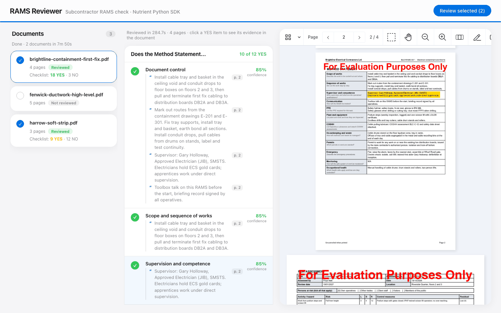
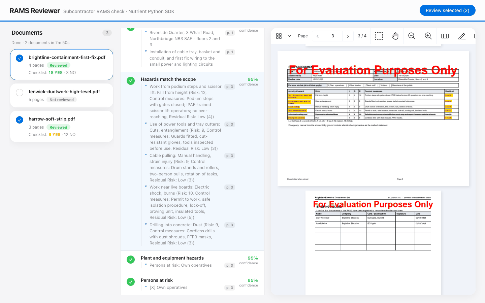

# Nutrient RAMS Review

A Nutrient.io demo that checks a subcontractor's RAMS pack (risk assessment and method statement) against a review checklist, answers YES or NO for each question with the verbatim evidence and a confidence score, and highlights the evidence where it is in the document.



1. **Read.** The Nutrient Python SDK runs its ICR engine on the pack (born-digital or scanned PDF) and builds the page content: paragraphs, form cells and table rows, with table and form detection. The page-layout threshold is lowered to 0.2 so that the answer cells of form-style RAMS are kept.
2. **Extract.** One structured-extraction request per checklist section (method statement, risk assessment), or per group of items. Each checklist item is a field of the JSON schema, whose value is a list of short verbatim quotes: one per table row, list line or ticked option. The SDK sends the content and the schema to an LLM and returns, for every quote, a confidence score and the bounding boxes of its source on the page.
3. **Filter non-answers.** A quote can be present in the document and still not answer the question. Deterministic rules reject the printed guidance of the form ("to be entered here", "how will you..."), bare `N/A`, `None`, `TBC`, a dash, an unticked YES / NO toggle and questions copied as answers.
4. **Detect deleted text.** Authors delete rows by striking them through, which leaves no trace in the text. The SDK renders the page and the pixels inside each quote's own box are scanned: a text line crossed by a long dark run in its middle band is struck through, and the quote is discarded.
5. **Answer.** An item with at least one quote left is YES, otherwise NO. The confidence of an item is the average of its quotes.
6. **Review.** The Nutrient Web SDK viewer opens the pack. Clicking a YES item highlights all its evidence, one box per quote.

The app is a FastAPI backend and a static front end, packaged as one container for Azure Container Apps or any container host.

## Prerequisites

- Python 3.12 or later
- macOS on Apple Silicon or Linux x86_64 (the Nutrient Python SDK native runtimes)
- About 1 GB of disk space for the ICR models. The SDK downloads them on the first run.
- An LLM: an OpenAI or Anthropic API key, an OpenAI-compatible endpoint (for example an Azure-hosted deployment), or Ollama with a local model such as `qwen2.5:7b-instruct`
- Optional: Docker

## Environment variables

Copy `.env.example` to `.env` and fill in what you need. Keys are only read from environment variables, never from code.

| Variable | Purpose | Default |
|---|---|---|
| `NUTRIENT_LICENSE_KEY` | Nutrient Python SDK license key | empty = evaluation mode |
| `NUTRIENT_WEB_SDK_LICENSE_KEY` | Nutrient Web SDK license key, served to the browser by `GET /api/config` | empty = evaluation mode |
| `AI_PROVIDER` | `openai`, `anthropic`, `local` (any OpenAI-compatible endpoint) or `ollama` | `openai` |
| `AI_API_KEY` | API key of the provider. Not needed for `ollama` | empty |
| `AI_MODEL` | Model of the extraction | `gpt-4o`, `qwen2.5:7b-instruct` with `ollama` |
| `AI_ENDPOINT` | Custom endpoint, for `local` | empty |
| `OLLAMA_URL` | Ollama server, for `ollama` | `http://127.0.0.1:11434` |
| `OLLAMA_MAX_TOKENS`, `OLLAMA_PRESENCE_PENALTY` | Answer length cap and presence penalty added to Ollama requests. A small model can otherwise loop inside a JSON array until the context limit | `2000`, `0.6` |
| `AI_ITEMS_PER_REQUEST` | Checklist items per extraction request. `0` sends a whole section at once. A small local model answers better with `3`, at the cost of more requests | `0` |
| `AI_PAGE_IMAGES` | `1` also sends the page images to the model. More tokens | `0` |
| `VISION_FEATURES` | SDK vision features, comma separated (`TABLE`, `FORM`, `KEY_VALUE_REGION`, `HANDWRITING`...). Table and form detection keep the rows and answer cells together. The license must include each feature | empty = all features |
| `LAYOUT_CONFIDENCE` | Threshold of the SDK page-layout model. The SDK default (0.5) drops answer cells and table rows on form-style RAMS | `0.2` |
| `PORT` | Server port | `8080` |
| `INPUT_DIR`, `OUTPUT_DIR` | Documents folder, and folder of the review results (one JSON per document) | `inputs/`, `outputs/` |

With `AI_PROVIDER=ollama`, the SDK calls Ollama through a relay in the app (`/internal/ollama`, reachable from the machine only). The relay removes the token log-probability request, which Ollama cannot answer in the form the SDK expects; the confidence score is then the SDK's grounding score. Nothing leaves the machine.

In evaluation mode the Python SDK hides part of the recognized text ("This content is hidden in trial mode"), so many items come back NO, and the viewer shows a watermark. Ask Nutrient for an evaluation license key to see complete reviews.

## Build and run

```bash
cp .env.example .env
```

```bash
./run.sh
```

Open <http://localhost:8080>.

`run.sh` creates `.venv`, installs `backend/requirements.txt` on the first run, loads `.env` and starts uvicorn. The viewer loads the Nutrient Web SDK 1.6.0 from `https://cdn.cloud.pspdfkit.com/pspdfkit-web@1.6.0/`.

### With Docker (Azure Container Apps)

```bash
docker build -t nutrient-rams-review .
```

```bash
docker run --rm -p 8080:8080 --env-file .env nutrient-rams-review
```

On Azure, push the image to your registry and create a Container App with the same environment variables, the keys as secrets.

## Using the app

1. **Review.** Press **Review all documents**, or tick the circles of a selection first. The progress bar shows the section being checked. Documents to review go in `inputs/`.
2. **Read the result.** Select a document. Each section shows its YES count. A YES item lists its quotes with their page; a NO item says it is not covered.
3. **Check the evidence.** Click a YES item: the viewer jumps to its first quote and highlights every quote of the item.

   

The screenshots were taken with a Nutrient Python SDK license key and the local model `qwen2.5:7b-instruct` through Ollama, with `AI_ITEMS_PER_REQUEST=3`. A small local model misses some evidence (here the COSHH assessment of the pack) and can quote the wrong passage (here for document control): treat the result as a first pass for the reviewer.

## The checklist

`backend/checklist.py` holds a generic checklist built from what a method statement and a risk assessment are usually expected to cover. Each item has a key, a label, a description of what the document must provide (the description goes into the schema sent to the LLM) and the maximum number of quotes. Edit the lists to match your own review form.

| Section | Items |
|---|---|
| Method statement | document control, scope and sequence of works, supervision and competence, briefing of the workforce, task-specific PPE, plant, tools and equipment, hazardous substances (COSHH), housekeeping, waste and environment, permits to work, emergency arrangements, monitoring and review, occupational health |
| Risk assessment | assessment details, hazards match the scope, plant and equipment hazards, persons at risk, controls beyond PPE, risk rating, health hazards, exposure limits, emergency scenarios |

## API

| Method and path | Description |
|---|---|
| `GET /api/files` | The documents in `INPUT_DIR` with their page count |
| `GET /api/pdf?name=x.pdf` | A document |
| `POST /api/process?file=x.pdf` | Reviews a document. Returns both checklists: for each item the answer, the quotes with confidence, page and boxes |
| `GET /api/progress?job=...` | Progress of a review started with `&job=...` |
| `GET /api/config` | `{ web_sdk_license_key }` |

## Samples

`inputs/` holds three fictitious RAMS packs, each a cover sheet, a method statement form (printed label and guidance on the left, the author's answer on the right), a risk assessment table and a briefing record. Every company, project, person and reference in them is invented.

| File | Built to show |
|---|---|
| `fenwick-ductwork-high-level.pdf` | A complete pack: every item is covered |
| `brightline-containment-first-fix.pdf` | A good pack with gaps: few persons at risk ticked, a struck-through hazard row, no exposure limits, monitoring `N/A` |
| `harrow-soft-strip.pdf` | A weak pack: form guidance left in place, `N/A` and `TBC` answers, generic PPE, rows deleted with a line through them |

To regenerate them:

```bash
pip install -r samples/requirements.txt
```

```bash
python samples/generate_rams.py
```

## Layout

| Path | Role |
|---|---|
| `backend/app.py` | FastAPI: review, progress and document endpoints, Ollama relay, static front end |
| `backend/checklist.py` | The checklist as an extraction schema, and the instructions sent to the LLM |
| `backend/extraction.py` | SDK structured extraction, confidence and boxes per quote |
| `backend/answer_filter.py` | Rejection of non-answers |
| `backend/strikethrough.py` | Pixel check for struck-through evidence |
| `frontend/` | Reviewer UI: document list, checklist, Web SDK viewer with highlights |
| `inputs/` | Sample RAMS packs |
| `samples/` | Sample generator |
